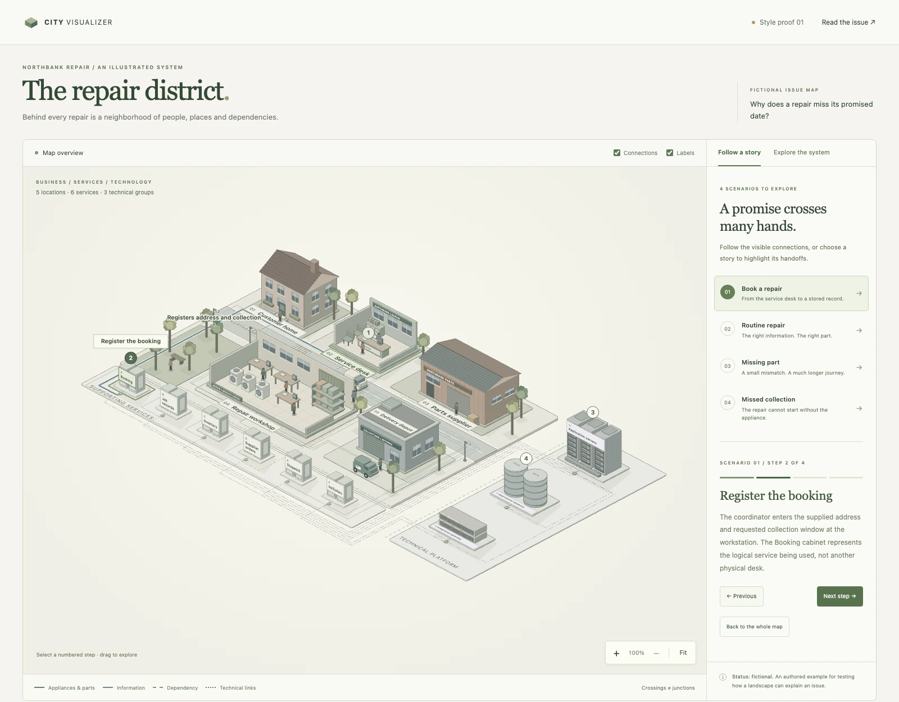

# CityVisualizer

Create detailed, interactive isometric maps that explain issues, services and systems through places, people and connected stories.

The toolkit supports cities, campuses, buildings, workspaces and technical systems, with animated journeys and nested views. Generated HTML pages are self-contained and work offline.

[](https://espenbamberg.github.io/city-visualizer/)

## What can you use it for?

CityVisualizer helps explain processes that cross several people, places or systems. Readers can follow a journey, inspect a location and explore the work inside it. It makes handoffs, dependencies and exceptions visible alongside the main story.

- **Customer journeys.** Show how people interact with a product or service over time. Make touchpoints, decisions and handoffs easy to follow.
- **Technical systems.** Show how components connect, exchange information and depend on each other. Let readers move from the overview into the details.
- **Complex issues.** Explain how people, organizations and resources influence an outcome. Explore different perspectives and show how a change in one area affects another.
- **Training and onboarding.** Turn unfamiliar processes into guided, step-by-step explanations. Help people understand their role and how their work fits into the whole.
- **Workflows.** Show how work moves between people and teams. Make responsibilities, dependencies and bottlenecks visible.
- **Storytelling.** Create explorable settings where people, places and events connect. Let readers follow a story or discover the world at their own pace.

Use the result in documentation, workshops, lessons, presentations or public-facing explainers. Each map comes with editable input data and a standalone HTML page, so you can revise the explanation and share it without running a server.

### Example prompts

> Use city-visualizer to turn the attached description into an interactive customer journey, from first contact to ongoing support. Show the key touchpoints, decisions and handoffs between the customer and our teams. Include a typical journey and an alternative where the customer needs extra help. At each step, explain what the customer needs, who responds and what happens next.

> Turn this process description into an interactive map for new employees who are unfamiliar with how we work. Show who owns each step, what information they need and how work passes between teams. Let readers explore the main activities in more detail. Include a normal workflow and an exception, and use plain language to explain how each role contributes to the outcome.

> Explain the system described in these notes as an interactive map for a mixed technical and non-technical audience. Start with an overview of its main parts, then let readers explore the details. Follow one request through the system, showing how information moves and which dependencies matter. Add a second scenario where a dependency is unavailable, and explain the effect on the user.

## Build an example

With a current Node.js installation, run:

```sh
node scripts/build.mjs examples/repair-service preview
```

Open `preview/index.html` for the interactive map and `preview/assets.html` for its component study. No package installation is needed.

For a building with nested views:

```sh
node scripts/build-v2.mjs examples/landscapes/building preview/building
```

## Use as an AI skill

The skill entry point is [SKILL.md](SKILL.md). Keep this entire directory together when installing it in your assistant's skills directory, including the kit, examples, references and attribution files.

Ask: **“Use city-visualizer to explain [issue] as an interactive map.”**

## Author your own map

- Start with [the brief template](templates/brief.md).
- Read [issue mapping](references/issue-mapping.md), [landscape selection](references/landscapes.md) and [the data contract](references/scene-data.md).
- Keep editable inputs separate from generated output. Build with explicit input and output paths.
- See [verification](references/verification.md) for model and browser checks.

Run the model/CLI checks:

```sh
node scripts/check.mjs
```

## Credits

CityVisualizer was created by Espen Bamberg, inspired by [Bo Meyer’s](https://www.linkedin.com/in/bo-meyer-65a0092/) work in visual modelling and explaining complex systems through illustrated landscapes. Hear more about his approach in Knowit’s *Forenklingspodden*: [“Bo Meyer – om Strategi som kunst”](https://podcasts.apple.com/it/podcast/bo-meyer-om-strategi-som-kunst/id1749310254?i=1000692304560).

Includes the MIT-licensed Anatomy geometry core by Ryan. See [THIRD-PARTY.md](THIRD-PARTY.md) and [its license](kit/anatomy/LICENSE).
